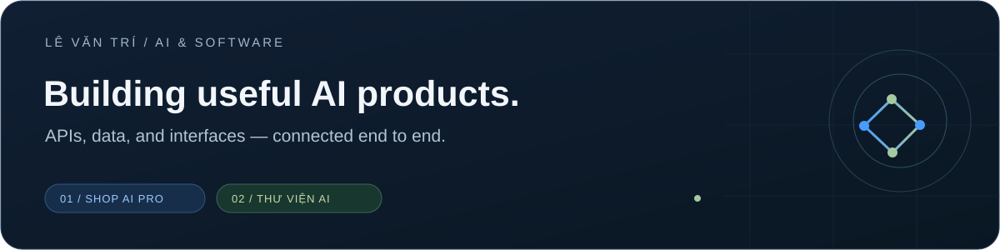

# Hi, I'm Lê Văn Trí

**AI applications · API platforms · Backend development**

I build practical products that connect AI models, reliable data, and clear user experiences.

[SHOP AI PRO](https://shopaipro.tech) · [Thư Viện AI](https://chatbot-library-jet.vercel.app) · [My projects](#selected-projects) · [Contact](#lets-connect)

---

## About me

My work sits between **AI integration, backend systems, and product development**. I enjoy turning an idea into something people can open, use, and inspect — with working APIs, a usable interface, and documentation that matches the implementation.

My two featured projects are **SHOP AI PRO**, an AI service platform, and **Thư Viện AI**, a Vietnamese library assistant with source-grounded answers.

## Selected projects

<table>
<tr>
<td width="50%" align="center" valign="top">
 

<h3>SHOP AI PRO</h3>
<strong>AI services &amp; API access platform</strong>

Storefront, API key access, credit and usage management, model routing, and developer setup guides.

<a href="https://shopaipro.tech"><strong>Visit website ↗</strong></a> · <a href="https://github.com/levantri10/shopaipro-overview">Project overview</a>

<a href="https://shopaipro.tech/docs">Documentation</a> · <a href="https://shopaipro.tech/models">Models</a>

<code>Go</code> <code>Next.js</code> <code>TypeScript</code> <code>PostgreSQL</code> <code>Redis</code> <code>Docker</code>

 
</td>
<td width="50%" align="center" valign="top">
 

<h3>Thư Viện AI</h3>
<strong>Vietnamese library assistant</strong>

Find books, check stock, and ask about library information. Answers link back to retrieved sources, with direct lookup when AI is unavailable.

<a href="https://chatbot-library-jet.vercel.app"><strong>Try live demo ↗</strong></a> · <a href="https://github.com/levantri10/ChatBot_Library">Repository</a>

<a href="https://github.com/levantri10/ChatBot_Library#readme">Setup &amp; documentation</a>

<code>JavaScript</code> <code>Vite</code> <code>Node.js</code> <code>Supabase</code> <code>PostgreSQL</code> <code>Vercel</code>

 
</td>
</tr>
</table>

### What each project demonstrates

| | SHOP AI PRO | Thư Viện AI |
| --- | --- | --- |
| **Product focus** | AI service access and account resources | Library questions and book discovery |
| **Backend work** | Domain services, key access, credit and usage | Chat API, retrieval and catalog administration |
| **AI integration** | Model gateway and provider routing | nemotron-super with retrieved library context |
| **Public access** | Website, docs and an overview repository | Live demo and application repository |
| **Scope** | Overview is public; source code is private | Demo uses sample data and keyword retrieval |

The library assistant supports optional vector embeddings in the code; its current demo uses **keyword retrieval**, with citations and an explicit fallback. Its inventory and opening hours are illustrative, not official library records.

## Tools behind these projects

| Area | What I work on |
| --- | --- |
| **AI integration** | Model APIs, gateway integration, retrieval and grounded responses |
| **Backend &amp; data** | API design, authentication, validation, credit/usage and relational data |
| **Product interfaces** | Storefronts, dashboards, chat interfaces and responsive layouts |
| **Delivery** | Containerized services, serverless deployments, testing and documentation |

## How I approach a project

**Understand the user → connect the data → build the flow → test the behavior → deploy → document.**

I use AI tools to support development while keeping implementation details, limitations, and verification results clear. I care about products that work beyond a screenshot.

## Let's connect

[Email](mailto:trilv2706@gmail.com) · [LinkedIn](https://www.linkedin.com/in/levantri10/) · [SHOP AI PRO](https://shopaipro.tech) · [Thư Viện AI demo](https://chatbot-library-jet.vercel.app)

 

Two projects. One focus: useful AI products with clear interfaces and dependable data.

